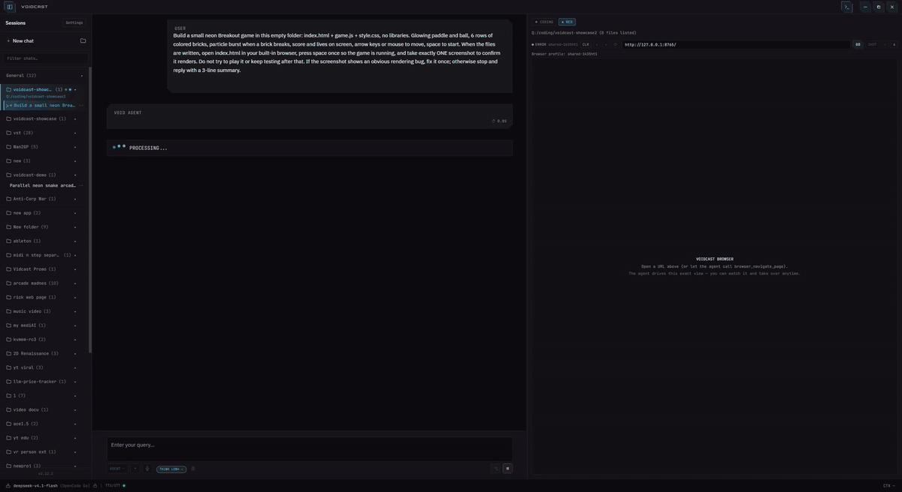
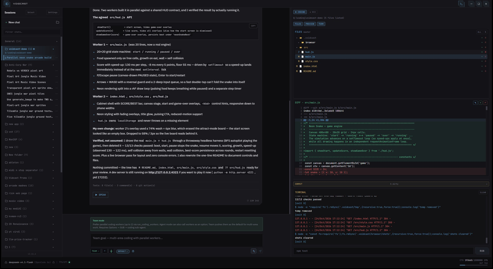
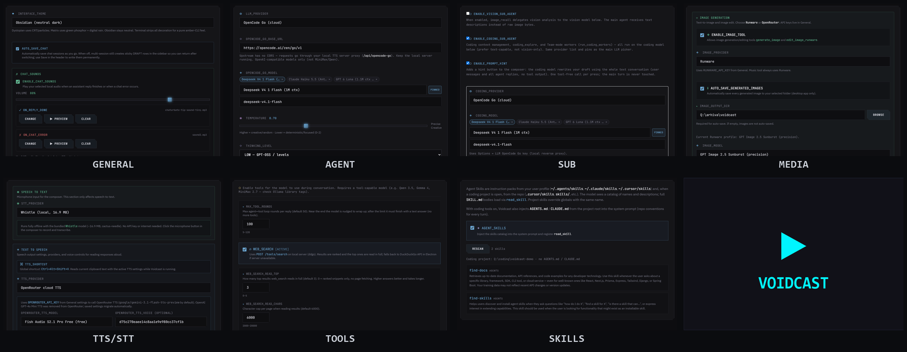
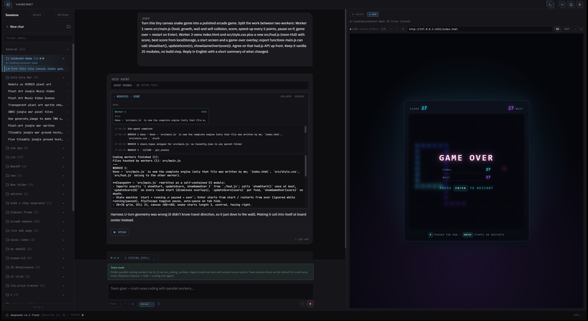
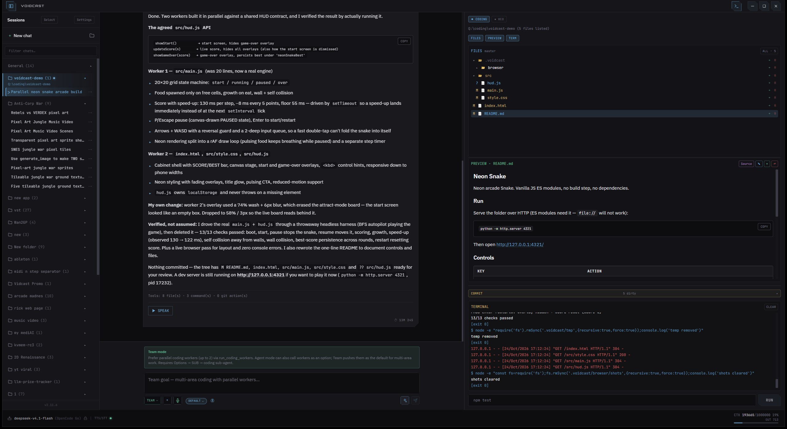
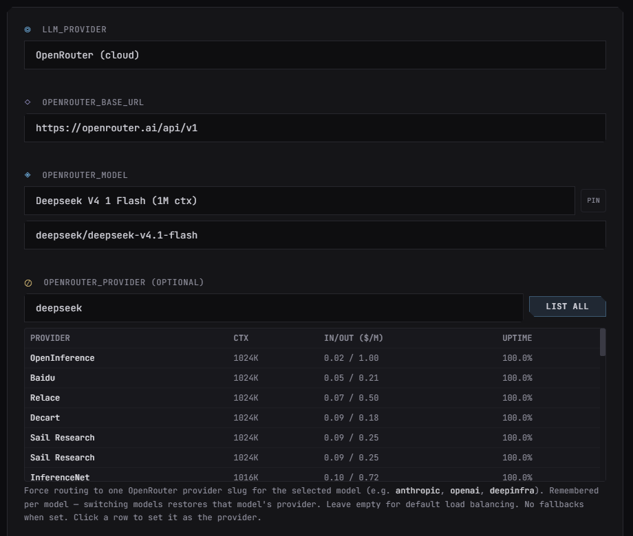
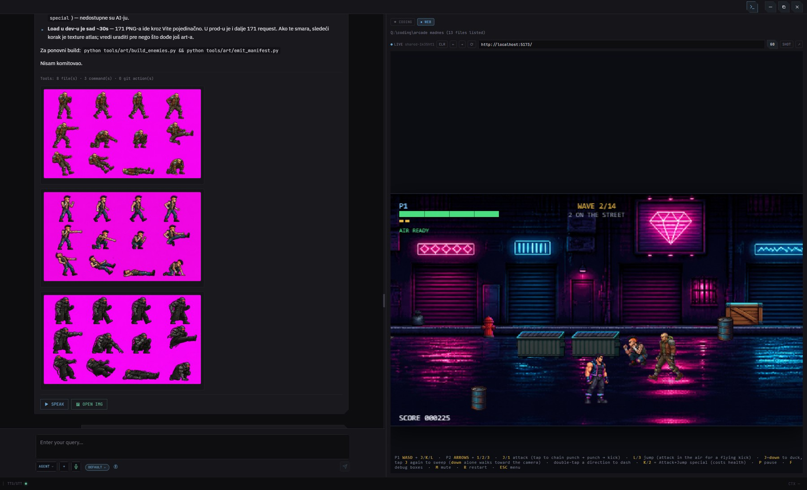

# Voidcast


<p align="center">
  <a href="https://github.com/boromanx386/Voidcast/releases/latest"></a>
  <a href="LICENSE"></a>
  
  <a href="https://github.com/boromanx386/Voidcast/releases"></a>
  
</p>

**A desktop coding agent that checks its own work — on your own keys.** Voidcast is a desktop AI agent (Electron + React + Python) that puts a multi-provider chat, a real coding agent, a browser it drives for you, and generative media tools in a single app. It runs on **your provider** — bring a key you already pay for (**OpenRouter**, **NVIDIA NIM**, **DeepSeek**, **OpenCode Go**, or **any endpoint** — OpenAI, Anthropic, LM Studio, vLLM — through **Custom**), or run models on your own hardware with **Ollama**. No account with us, no credits to buy, no markup, no telemetry.

Providers: **OpenRouter** · **NVIDIA NIM** · **DeepSeek** · **OpenCode Go** · **Ollama** · **Custom** (any endpoint) — plus **Runware** for image and music. See [Providers](#providers).

<p align="center">
  
</p>
<p align="center"><em>One prompt in Agent mode: the agent writes a neon Breakout game into an empty folder, opens it in the built-in browser and checks it runs (~2 min of work, build part sped up 5×).</em></p>

## Why Voidcast

- **Made for models you can afford.** The coding prompt is short and keeps the agent on the task, so DeepSeek or GLM on a $10/month OpenCode Go plan does real work: building, fixing, testing. How it does on real tasks: [Benchmark](docs/benchmark.md).
- **It checks its own work.** The agent runs your tests, build and type checks after it edits, and for anything with a UI it can open the result in its own browser and click through it. You watch the same view and can take over any time.
- **More than code.** The same agent searches the web, reads YouTube transcripts, drives a browser you can take over, generates images and music, speaks with TTS and writes PDFs, all inline in the chat.
- **A worker for your main agent.** Claude Code, Codex or Cursor can hand Voidcast a task through the [local control API](docs/control-api.md) and read the result: cheap bulk work, or tools your main agent lacks.
- **Your keys, your machine.** No account with us, no credits, no markup, no telemetry.

<details>
<summary><strong>Table of contents</strong></summary>

- [Why Voidcast](#why-voidcast)
- [Main features](#main-features)
- [Get started (one click)](#get-started-one-click)
- [Updates (desktop)](#updates-desktop)
- [The agent & tools](#the-agent--tools)
  - [Music (Runware or Lyria)](#music-runware-or-lyria) · [PDF export](#pdf-export) · [Agent skills](#agent-skills) · [MCP servers](#mcp-servers-desktop) · [Built-in browser](#built-in-browser) · [Chat modes](#chat-modes)
- [Coding tools](#coding-tools)
- [Providers](#providers)
- [OpenRouter support](#openrouter-support-per-model-provider-routing)
- [Context compression](#context-compression)
- [Long-term memory](#long-term-memory)
- [Image-aware chat](#image-aware-chat)
- [Themes & UI](#themes--ui)
- [Speech & audio](#speech--audio)
- [Development](#development)
- [License & third-party](#license--third-party)

</details>

---

## Main features

<p align="center">
  
</p>
<p align="center"><em>Sessions on the left, the agent running parallel tools and workers in chat, and the coding panel with file tree, diff, commit bar and terminal.</em></p>

- **Everything in one window** — chat, coding, web tools and generative models together. The agent invokes search, YouTube, image generation/edit, music and PDF, and **results appear inline** in the conversation. No tab juggling.

- **Run several agents at once** — start work in one session, open another, keep both running (up to **3 concurrent agent turns**). Each chat keeps its own messages, project and tool loop, and Stop cancels only the active session. **Team** mode adds up to **2 parallel coding workers**. See [Multi-chat & Team](docs/multi-chat-and-team.md).

- **A real coding agent** — point it at a project folder and it reads, edits, searches and greps your code, runs **git** and **shell** commands, and drives an integrated IDE panel (file tree, diff, commit bar, terminal). Modes cover full implement (**Agent**), read-only Q&A (**Ask**), explore-then-**Approve & Build** (**Plan**), and multi-file orchestration with workers (**Team**). Project context persists per repo. See [Coding tools](#coding-tools).

- **A browser it actually drives, that you can take over** — Voidcast ships its **own Chromium** (the coding panel **WEB** tab). You and the agent share the same view: navigate, click, type, snapshot, screenshot, emulate devices. Clicks are real CDP input, so React apps and canvas games react as to a real user. See [Built-in browser](#built-in-browser).

- **BYOK — your providers, your billing** — use the accounts and keys you already pay for (OpenRouter, NVIDIA NIM, DeepSeek, OpenCode Go, or any endpoint through Custom), or run models on your own hardware with Ollama. Nothing is resold: no credits to buy from us, no markup. **OpenRouter** alone unlocks 300+ models from a single key. Keys and settings stay on your machine; Voidcast has no cloud account and never receives your keys. See [Providers](#providers).

- **Pick who serves each model on OpenRouter** — the same open model is hosted by many providers at different prices, speeds and quantizations. **LIST ALL** shows every host for the selected model with its quantization (fp8, fp4…), input/output and cache-hit price and uptime; click one and requests go **only** there, no fallbacks. The choice is remembered per model, and each chat keeps its upstream prompt cache warm. See [OpenRouter support](#openrouter-support-per-model-provider-routing).

- **Tools that do things** — web search, YouTube search + transcripts, web scraping, PDF export, image generation and edit, music generation, TTS/STT, long-term memory, plus **MCP servers** (stdio or remote URL, including OAuth). See [The agent & tools](#the-agent--tools).

- **Watch it think** — adjacent read-only tool calls run in parallel (up to ten) while serial and mutating calls stay ordered. The chat shows active tool names and keeps intermediate drafts in collapsible round blocks.

- **A worker for Claude Code, Codex and Cursor** — turn on the local control API, copy [`skills/voidcast/`](skills/voidcast/) into your agent's skills folder, and your main agent can hand Voidcast a task, wait for it and check the result. Let a cheaper model do the bulk work, or use Voidcast's image, music, TTS and browser tools from another agent. See [Local control API](docs/control-api.md).

---

## Get Started (One Click)

| Platform | Download | Status |
|----------|----------|--------|
| **Windows 10/11 (x64)** | [`Voidcast_x.y.z_Setup.exe`](https://github.com/boromanx386/Voidcast/releases/latest) | One-click setup. No Python. No pip. No terminal. |
| **Linux (x64)** | [AppImage or `.deb`](https://github.com/boromanx386/Voidcast/releases/latest) | AppImage: `chmod +x` and run — it updates itself. `.deb`: `sudo apt install ./Voidcast_*.deb` — manual updates. |

1. Download the build for your platform from [Releases](https://github.com/boromanx386/Voidcast/releases/latest)
2. Install it: Windows — run the setup, Next → Next → Done. Linux — `chmod +x Voidcast_*.AppImage && ./Voidcast_*.AppImage`, or `sudo apt install ./Voidcast_*.deb`.
3. On first launch the chat asks how to connect a model: paste an OpenRouter key (or the key of another cloud provider), or pick a model your local Ollama already has. Keys are stored only on your PC; more go in **Options → General → CLOUD_API_KEYS**.
4. Start the agent.

> ⚠️ **Windows SmartScreen:** the installer is not code-signed yet, so Windows may show "Windows protected your PC". Click **More info → Run anyway**. The build comes straight from the [release workflow](.github/workflows/release.yml) on GitHub Actions.

> 💡 **Already have a key? First launch to first chat is under a minute.** The packaged app bundles the Python tools server, so there is no Python/pip setup — just add keys and go.

Requires Windows 10/11 or a 64-bit Linux desktop (X11/Wayland).

---

## Updates (desktop)

The packaged desktop app (Windows installer, Linux AppImage) can check [GitHub Releases](https://github.com/boromanx386/Voidcast/releases) for new versions (optional — off by default).

In **Options → General**:

- **`AUTO_UPDATE`** — when enabled, checks on startup, downloads in the background, and prompts **Install now** / **Later** when ready.
- When disabled, use **`CHECK FOR UPDATE`** anytime for a manual check.

You choose whether updates run automatically; nothing is forced without your toggle.

> 🐧 On Linux the same flow works for the **AppImage** build only — `electron-updater` has no `.deb` updater, so a `.deb` install is updated by downloading a new package.

---

## The Agent & Tools

Voidcast runs an **agent tool loop**: the model decides when to call a tool, the app executes it, and the result goes back to the model.

Available tools:

- **Web Search** — real-time DuckDuckGo search
- **YouTube** — search videos + fetch transcripts
- **Web Scrape** — fetch and summarize public pages
- **Built-in Browser** — drive a real Chromium view inside the app (coding panel **WEB** view): navigate, click, type, snapshot, screenshots, console/network, device emulation — no external Chrome (see below)
- **PDF Export** — agent writes a formatted PDF to a folder you configure (Python tools server / ReportLab)
- **Image Generation** — Runware or **OpenRouter** (Gemini Flash Image, GPT Image 2)
- **Image Edit** — Runware or OpenRouter; reference images from chat
- **Music / Audio Generation** — Runware ACE-Step v1.5 (Turbo, Base, XL Turbo/Base/SFT) or Google Lyria 3 through OpenRouter; see below
- **Text-to-Speech** — `generate_tts` uses the active TTS provider and saves a real audio file; project-relative output paths are supported on desktop
- **Plan Mode** — `enter_plan_mode` switches the chat into a read-only plan flow (explore first, then approve) before coding
- **Coding Tools** — read, write, edit files; run git and shell commands (see below)
- **MCP Servers (desktop)** — connect external MCP tools from `~/.voidcast/mcp.json` (see below)

All providers share the same tool catalog and executor. See [Providers](#providers) for the list and what each gives you.

<p align="center">
  
</p>
<p align="center"><em>Options — General, Agent, Sub, Media, TTS/STT, Tools and Skills in one composite. Every tab is documented in <a href="docs/options/README.md">docs/options</a>.</em></p>

### Music (Runware or Lyria)

In **Options → Media → Music tool**, choose the provider: **Runware ACE-Step** or **Google Lyria 3** through OpenRouter (**Lyria 3 Pro** for full songs with vocals, **Lyria 3 Clip** for 30-second clips; uses your OpenRouter key). For Runware, pick **ACE-Step v1.5 Turbo** (fast defaults, steps capped at 20), **ACE-Step v1.5 Base** (higher quality, steps up to 300), or one of the 4B **XL** variants — **XL Turbo** (8-step distilled, steps capped at 20), **XL Base** (50-step CFG, up to 300 steps) and **XL SFT** (flagship quality, up to 300 steps). Each model keeps its own profile (duration, format, steps, seed). Tuning stays in Options — the agent does not override music parameters via tool args.

### PDF Export

Enable **SAVE_PDF** and set **PDF_OUTPUT_DIR** in **Options → Tools** (folder on the host running the tools server). The agent calls `save_pdf`; files land there with no save dialog.

Supports Markdown-lite (headings, lists, tables, bold). Images can come from chat attachments or Runware URLs from a prior image/music turn.

### Agent Skills

In **Options → SKILLS**, Voidcast discovers instruction packs from `~/.agents/skills` and, when a coding project is open, from the repo's `.cursor/skills`, `.claude/skills`, `.agents/skills` and `skills/`. `~/.claude/skills` and `~/.cursor/skills` are not scanned. Each skill is a directory containing `SKILL.md`.

On every turn, the agent sees a **catalog** of skill names and descriptions. When a request matches a skill, it loads the full `SKILL.md` on demand via `read_skill`. This keeps the system prompt lean while still making specialized workflows available. Project skills override globals with the same name.

With coding tools on, Voidcast also injects **`AGENTS.md` / `CLAUDE.md`** from the project root into the system prompt — repo conventions available on every turn.

### MCP Servers (desktop)

In **Options → Tools → MCP_SERVERS**, enable MCP and edit `~/.voidcast/mcp.json` (OPEN_CONFIG). Servers can be:

- **stdio** — `command` / `args` / `env` (e.g. `npx -y @runware/mcp`)
- **remote** — `url` (Streamable HTTP or SSE). Optional `"oauth": true` opens a browser sign-in; tokens live under `~/.voidcast/mcp-oauth/`.

Project **`.mcp.json`** merges with the global file and stays blocked until you click **TRUST_PROJECT_MCP** (server preview first); toggle servers individually or **RELOAD** to reconnect.

The agent discovers tools progressively (`mcp_list_tools` → `mcp_get_tool` → `mcp_call`) so schemas do not flood the context window; large results spill to `~/.voidcast/mcp-results/`. MCP write/call tools are blocked in Plan mode, and chat **Stop** cancels in-flight calls.

Example remote OAuth entry:

```json
{
  "mcpServers": {
    "runware": {
      "url": "https://mcp.runware.ai",
      "oauth": true
    }
  }
}
```

### Built-in Browser

Voidcast ships its **own Chromium view** — no external Chrome, no browser extension. It is the coding panel's **WEB** tab, and **you and the agent share the same view**: watch it work, take over any time.

- **`browser_*` tools** — navigate, click, fill, press key, accessibility snapshot, screenshots, console/network, device emulation.
- **Multi-page** — up to **8** tabs; links that open a new window become a page here instead of the system browser.
- **Real input** — clicks and keys are dispatched as real CDP input events, so React/Vue apps and canvas games react exactly as to a real user.
- **Locked down by default** — permissions denied unless `fullscreen`, `clipboard-sanitized-write` or `pointerLock`; downloads go to `<project>/.voidcast/browser/downloads/`, never the OS folder.

Full tool reference: [docs/options/tools.md](docs/options/tools.md).

<p align="center">
  
</p>
<p align="center"><em>The WEB tab is a real Chromium view, shared with the agent — here it served the game it just built and play-tested it before reporting back. Take over any time.</em></p>

### Chat modes

Composer chip (or `Shift+Tab`) cycles **Agent → Ask → Plan → Team**:

| Mode | Role |
|------|------|
| **Agent** | Full tools — implement in the main loop (code, media, options, MCP, terminal as enabled). |
| **Ask** | Read-only Q&A: explore and explain; no writes, no workers, no plan tools. |
| **Plan** | Read-only research + plan card (editable steps; optional A/B approaches). No edits until approval. |
| **Team** | Like Agent, plus `run_coding_workers` (up to **2** parallel coding tasks under optional path scopes). Parent waits for workers; no nested workers. |

- **Approve & Build** (from Plan) — implements with **Team** if Team is selected in the composer, otherwise **Agent**. Live step progress via `update_plan_progress`. Stop/errors allow **Retry Build**; **Built** only after at least one step is checked off.
- Plan tools `enter_plan_mode` / `update_plan_progress` are available in Agent / Plan / Team (not Ask).
- MCP writes and mutating coding tools stay blocked in Plan and Ask.

Full walkthrough: [docs/multi-chat-and-team.md](docs/multi-chat-and-team.md).

---

## Coding Tools

Right-side panel with file tree, file preview, and terminal output. The agent acts as a junior dev in your project folder:

- `list_directory`, `read_file`, `write_file`, `edit_code`
- `search_files` (bundled ripgrep; walk fallback)
- `glob_files`
- `find_symbols` — read-only symbol outline (functions, classes, methods, types, headings) with 1-based line numbers; regex-based per-language heuristics (TS/JS, Python, Go, Rust, Markdown), no external deps. Line numbers feed `edit_code` `start_line`/`end_line`.
- `git_status`, `git_diff`, `git_log`, `git_show`
- `git_restore` — undo a bad edit on a tracked path (worktree from index, or `to_head` to reset to HEAD); `git_stash` — checkpoint without committing (`list` / `push` / `pop`). Both blocked in Plan mode.
- `check_types` — TypeScript (`tsc --noEmit`), Python (`ruff check`, then `pyright`), Go (`go vet`), or Rust (`cargo check`); auto-detects from `path_prefix` / file paths (e.g. `tts-server`); optional `paths` to filter after edits
- `execute_command` (with timeout + `run_in_background` flag for dev servers/watchers)
- `list_processes`, `stop_process`, `read_process_output` — explicit process control (list active processes by runId, kill by runId, poll stdout/stderr with offset paging)
- `coding_explore` — read-only codebase exploration via sub-agent
- `run_coding_workers` — **Team** mode only: up to two parallel workers for multi-area edits (see [Multi-chat & Team](docs/multi-chat-and-team.md))

Hardened tools: `edit_code` requires an exact `find_text` match, `write_file` writes atomically (temp+rename), and clear-result digests replace multi-thousand-char dumps from `git_diff`, `search_files`, and `list_directory`.

**Process awareness** — the agent sees active shell processes as a CTX hint and manages them explicitly with `list_processes` / `stop_process` / `read_process_output`. Implementation details: [docs/coding.md](docs/coding.md).

### Git integration

The coding panel surfaces git state and lets you commit without leaving the app:

- **Status colors** — dirty files are letter-coded in the tree: `M` yellow, `A` green, `D` red, `?` gray, `R` magenta; folders with changes turn yellow. Heavy folders (`node_modules`, `dist`, …) stay visible but dimmed.
- **Stage / unstage / discard** — inline buttons on each dirty file row (`+` / `−` / `↶`) and in the preview header.
- **Diff preview** — unified diff with line numbers and `@@` hunks; staged vs unstaged auto-selects from status.
- **Commit bar** — collapsible panel: **COMMIT** (staged only), **COMMIT ALL**, **DISCARD ALL**.
- **Dirty-only toggle** — "DIRTY N" / "ALL · N" filters the tree to changed files.

Full detail: [docs/coding.md](docs/coding.md).

### File preview & layout

- **Preview** — syntax highlighting (highlight.js) and rendered Markdown for `.md` / `.mdx` (with a **Source** toggle), plus an inline **✎ Edit** editor with find/replace (**Ctrl+S** save, **Esc** cancel).
- **Three-level split, all resizable** — chat ↔ panel, file tree ↔ preview/terminal, preview ↔ terminal. Drag any divider (or arrow keys / `Home` / `End`); sizes persist across restarts (`panelWidthPx` 416, `fileTreeHeightPx` 220, `terminalHeightPx` 200). The panel stays collapsed when the agent edits files — no auto-expand on every write.
- **Project instructions** — with coding tools on, `AGENTS.md` / `CLAUDE.md` from the project root is injected into the system prompt on every turn, and skills found in the repo show a `[project]` label and override global ones with the same name.

Full detail: [docs/coding.md](docs/coding.md).

<p align="center">
  
</p>
<p align="center"><em>File tree, preview, terminal and commit bar — all in one panel.</em></p>

**Project memory:** recent files, directories, command outcomes, and tool failures are stored **per project** in browser `localStorage` and survive app restarts. Opening the same repo again hydrates that snapshot into new chats; the active session still keeps live search/git hints for the current thread.

**Code search:** the desktop app bundles [ripgrep](https://github.com/BurntSushi/ripgrep) for fast `search_files` on large trees. Override with `VOIDCAST_RG_PATH` or a system `rg` on `PATH` if needed; otherwise the tool falls back to a built-in walk.

---

## Providers

Voidcast does not charge anything, takes no cut and has no cloud account. It connects you to the providers **you** already pay: a pay-as-you-go cloud, a subscription you already hold, or a model running on your own hardware. Nothing is resold — there are no Voidcast credits to buy, and your key is never proxied through us.

| Provider | What you get | Cost |
|----------|--------------|------|
| **OpenRouter** ⭐ | Claude, GPT, Gemini, DeepSeek + 300 more from one key — chat, **per-model provider routing**, TTS, and optional image models (Gemini Flash Image, GPT Image 2) | Free tiers + pay-as-you-go |
| **NVIDIA NIM** | Open models (Nemotron, Llama, Mistral, DeepSeek-R1…) on NVIDIA's hosted endpoints | Free — free developer tier, no subscription, no paid plan to buy. Free capacity is shared, so throughput varies and it is often slow |
| **DeepSeek** | Direct API — V4 Pro / Flash | Pay-as-you-go (prepaid balance) |
| **OpenCode Go** | Models via [OpenCode](https://opencode.ai/docs/go) — chat, Anthropic Messages and the Responses API, routed per model | Subscription (from $10/mo) |
| **Ollama** | Open-source models (Qwen, Gemma, GLM, Mistral…) on your own machine — or Ollama's hosted models | Your hardware: free · [Ollama Cloud](https://ollama.com/pricing), Ollama's own plans: free tier, Pro from $20/mo |
| **Custom** — any endpoint | OpenAI or Anthropic directly, vLLM, llama.cpp `llama-server`, LM Studio, TGI, SGLang, Groq — anything that speaks Chat Completions, Responses or Anthropic Messages; you pick the format | Whatever that endpoint costs; your own hardware: free |
| **Runware** | Image generation, image edit, and AI music (ACE-Step) | Pay-per-use (typically pennies) |

> **Ollama is not only local.** Ollama Cloud is a paid service of its own, so Voidcast lists Ollama as one provider of six — not as "the local option". The default provider is OpenRouter; a fresh install asks for its key, or lets you pick a model your Ollama already has.

> **Bring your own endpoint.** Every provider's base URL except OpenCode Go's is an editable field, so nothing here is a closed door. **Custom** takes any base URL in any of the three wire formats — point it at a local server (vLLM `http://localhost:8000/v1`, llama.cpp `llama-server` `http://localhost:8080/v1`, LM Studio, TGI, SGLang) or straight at OpenAI or Anthropic, then load or type the model id. It goes through the local tools server, so servers without CORS work. The same holds for `ollamaBaseUrl`, `openrouterBaseUrl`, `nvidiaBaseUrl`, and `deepseekBaseUrl`; OpenCode Go always goes through the tools server, whose upstream is the `OPENCODE_GO_BASE_URL` env variable.

> **Three wire formats, not one.** Voidcast is not a Chat-Completions-only client: it speaks the OpenAI **Chat Completions** API, the **Anthropic Messages** API (`{base}/messages`, with `x-api-key` and `anthropic-version`) and the OpenAI **Responses** API (`{base}/responses`) — **Custom** uses the one you pick, and the OpenCode Go provider routes every model to the right one automatically, including a runtime re-probe when Go refuses a format. Real adapters, not shims; details in [docs/options/llm.md](docs/options/llm.md). Requests reach OpenCode Go through the local tools server (`/api/opencode-go`), because Go sends no CORS headers; the app starts that server itself.

All you need are the accounts and API keys you already have — Voidcast never resells model access. Run models on your own hardware for free or use cloud keys on low-cost tiers; **TTS, STT, and image/music runs are very cheap** — usually cents per session, not dollars.

**Pricing:** OpenRouter Whisper (STT), TTS, and image models bill per request or token at low rates. Runware charges per image or audio clip at similarly small amounts. Voidcast adds no markup; see each provider’s pricing page for current numbers.

**Privacy:** API keys and app settings stay on your machine; on desktop the keys are encrypted with your OS key store (Windows DPAPI, Linux keyring). Voidcast has no cloud account and never receives your keys — the desktop app talks to OpenRouter, NVIDIA NIM, DeepSeek, OpenAI, OpenCode Go, Runware, or Ollama from your PC (OpenCode Go via the local tools proxy).

---

## OpenRouter support (per-model provider routing)

OpenRouter is a first-class provider in Voidcast: **one key, 300+ models** (Claude, GPT, Gemini, DeepSeek, Llama, Qwen…), plus optional image models and TTS. What most tools don't expose, Voidcast does — OpenRouter's **provider routing** is right in **Options → Agent**:

- **Pin the provider per model** — set `OPENROUTER_PROVIDER` to a slug (`anthropic`, `openai`, `deepinfra`, `deepseek`, …). Requests then go **only** to that provider (`provider.only`, no fallbacks), so latency, price and behaviour stop moving under you.
- **Remembered per model** — the lock is stored per model id (`openrouterProviderByModel`). Switch to another model and Voidcast restores *that* model's provider; switch back and it comes with it.
- **LIST ALL** — lists every provider currently serving the selected model, with its **quantization, input/output price, cache-hit price (per 1M tokens) and recent uptime**. Variants of one host (for example DeepInfra `fp8`, `fp8/flex`) show as separate rows. Click a row to apply it as the lock — the field fills in and saves instantly.
- **Sticky routing for upstream cache** — each chat sends a stable `session_id`, so OpenRouter keeps routing the conversation to the same **upstream** provider, keeping that provider's prompt cache warm. Note this is an OpenRouter routing aid, not the cache itself: Voidcast's cache-friendly prompt ordering (stable system prompt + history prefix, volatile context on the final turn) applies to **every** provider, and cache-hit tokens are tracked for Ollama, OpenAI, DeepSeek and OpenRouter alike — see [Context Compression](#context-compression).

Leave `OPENROUTER_PROVIDER` empty for OpenRouter's default load balancing across providers.

<p align="center">
  
</p>
<p align="center"><em>Options → Agent — OpenRouter model picker, the optional <code>OPENROUTER_PROVIDER</code> lock, and the <strong>LIST ALL</strong> table (provider · quant · price · cache hit · uptime). Click a row to pin it.</em></p>

Full field reference: [docs/options/llm.md](docs/options/llm.md).

---

## Context Compression

Local and small-context models hit a wall after long chats. When prompt usage nears the model limit (~90%), Voidcast can **auto-compress** (toggle in **Options → Agent**, or from the footer **CTX** popup): it summarizes older turns into a hidden memory buffer (provider-aware) and injects that into the system prompt on later turns. **The full chat stays visible in the UI**; only new messages after compression are sent again as raw turns to the model. Click the footer CTX meter for **COMPRESS NOW** anytime (including early on large-context models), or use the yellow warning banner when auto is off.

Prompts are ordered for **prompt-cache hits** (stable system prompt + history prefix, volatile context on the final user turn) — details in [docs/architecture.md](docs/architecture.md).

---

## Long-Term Memory

Cross-chat memory is stored locally in IndexedDB:

- Saved when you ask the agent to remember something
- Edit or delete anytime in **Options → General**
- Optional **USE_LONG_MEMORY_GLOBALLY** to include memories in every chat

---

## Image-Aware Chat

Paste images into the chat, or drag-and-drop images and documents. On desktop, **PDF** and **DOCX** attachments extract text the same way as the native file picker (main-process parsers). The assistant can analyze images via **image_recall** (always available, independent of the Runware toggle) and, when needed, recall them from conversation history for iterative visual work. **Generate or edit** images via Runware or OpenRouter from the same thread.

<p align="center">
  
</p>
<p align="center"><em>Paste an image and ask the agent to transform it — results appear inline.</em></p>

For **charts, diagrams, and infographics**, pick an image model in **Options → Media → Image tool** (Runware GPT Image 2, or OpenRouter Gemini Flash / GPT Image 2), describe what you want in chat, then ask the agent to export a PDF — it can pass the generated `image_url` from the prior turn into `save_pdf` so the graphic is **embedded in the document** (not just linked in markdown).

---

## Themes & UI

Seven built-in themes: **Obsidian** (default, dark violet accents), **Minimal**, **Dystopian**, **Matrix** (classic green-black with digital code rain), **Light**, **Blood Moon** and **Terminal** (amber-phosphor CLI look with CRT scanline texture). Switch anytime in **Options → General**. Empty-state hints and the composer placeholder adapt to the active theme.

Other UX features:
- **Pinned sessions sidebar** — chat sessions in a left column; toggle from the header (collapsed by default on narrow screens). Project folder groups default collapsed. Session history is stored in **IndexedDB** (migrated automatically from older `localStorage` data on first launch).
- **Pinned model switcher** — status-bar popup to jump between pinned models; pins are scoped per provider so the same slug on OpenRouter vs NVIDIA / DeepSeek / OpenCode Go / Custom does not collide.
- **Drag-and-drop** — drop images and supported files (TXT, MD, PDF, DOCX, CSV, JSON, code) onto the chat (same limits as the file picker); PDF/DOCX text is extracted on desktop
- **Edit any message inline** — history regenerates from that point
- **Fork chat session** — explore a different branch of the conversation
- **Export to Markdown** — entire chat as `.md`
- **Thinking blocks** — collapsible reasoning; for Ollama, choose **off / low / medium / high / on** in LLM options
- **Chat sounds** — optional local audio files for reply done and errors (**Options → General**)
- **Chat keyboard shortcuts** — Ctrl+S save session, Ctrl+N new chat, Shift+Tab cycle Agent → Ask → Plan → Team
- **Chat sessions grouped by project folder** — General chats at top, project-specific groups below
- **Start a chat for a project** — each project-folder group has a `+` button (revealed on hover) that starts a fresh chat already bound to that folder
- **Type while the agent is working** — the composer stays active during a running turn; type a correction and press Enter to **Steer** (abort + redirect mid-turn), or wait for the turn to finish
- **Custom Windows title bar** — cyber-btn header controls replace native caption buttons
- **Coding process badge** — active foreground/background processes shown in the status bar

---

## Speech & Audio

- **Text-to-Speech** — Local OmniVoice (free on your PC; requires `.venv` setup, see `LOCAL_TTS_SETUP.md`), or cloud via Runware / OpenRouter TTS (very low cost per reply)
- **Speech-to-Text** — local **Whistle** via the bundled `cactus-needle` engine (fully offline, no API key; ~16.9 MB, 7 languages) or OpenRouter Whisper (push-to-talk; inexpensive per recording)

Cloud voice options are pay-per-use; see [Providers](#providers) above for typical costs.

---

## Development

Run from source with `npm run dev` from the repo root (Node.js 20+, Python 3.12+). Install steps, builds for Windows and Linux, releasing and the repository layout are in [docs/development.md](docs/development.md).

---

## License & Third-Party

MIT License.

Voidcast uses:
- **Electron** — MIT
- **Tailwind CSS** — MIT
- **Lucide Icons** — ISC
- **Runware** — Commercial API (free tier available)
- **cactus-needle / Whistle** — Apache-2.0 (bundled offline STT engine; see [THIRD_PARTY_NOTICES.md](THIRD_PARTY_NOTICES.md))

---

Maintained by one developer. If Voidcast is useful to you, a ⭐ helps others find it — and [open an issue](https://github.com/boromanx386/Voidcast/issues) anytime with bugs or ideas. Want to send a change? Start with [CONTRIBUTING.md](CONTRIBUTING.md). Found a security problem? See [SECURITY.md](SECURITY.md).
