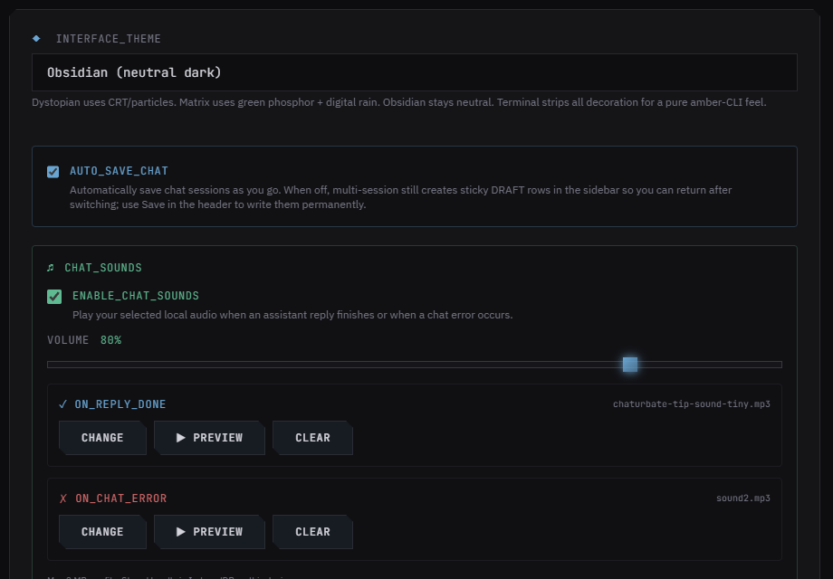

# General Tab

> Grounded in `electron-app/src/components/options/GeneralOptionsPanel.tsx` and `electron-app/src/lib/settings.ts`.

  

<em>Options → General.</em>

## Interface Theme

- **Field:** `uiTheme`
- **Type:** `UiTheme` (`'dystopian' | 'minimal' | 'matrix' | 'light' | 'blood-moon' | 'obsidian' | 'terminal'`)
- **Default:** `'obsidian'`

Selects the visual chrome of the app. The `dystopian` and `matrix` themes also enable ambient effects (CRT overlay, particles, or matrix rain) behind the settings screen.

## Cloud API Keys (`CloudApiKeysSection`)

All cloud API keys are stored locally on this device (device storage in the desktop app, encrypted with the OS key store).

Pick a provider chip to edit its key. A filled green dot means a key is already set.

| Provider | Setting field | Placeholder / where to get it |
| --- | --- | --- |
| OpenRouter | `openrouterApiKey` | `sk-or-v1-...` — https://openrouter.ai/keys |
| DeepSeek | `deepseekApiKey` | `sk-...` — https://platform.deepseek.com/api_keys |
| NVIDIA | `nvidiaApiKey` | `nvapi-...` — https://build.nvidia.com/ |
| OpenCode Go | `opencodeGoApiKey` | `sk-...` — https://opencode.ai/auth |
| Runware | `runwareApiKey` | `rw_...` — https://runware.ai/ |

These keys are in `AGENT_HIDDEN_SETTINGS_FIELDS` in `settings.ts` — the agent never sees them.

## Chat & Updates

- **Auto-save chat** — `autoSaveChat` (`boolean`, default `true`). When enabled, chat sessions are saved automatically. When off, a manual save button appears in the chat UI.
- **Auto-update** — `autoUpdate` (`boolean`, default `false`, desktop only). If enabled, the app checks for updates automatically on startup. You can also run a manual “Check for updates…” from this panel; update status/download availability is reported via the desktop updater bridge.

## Notification Sounds

- **Enable sounds** — `notificationSoundsEnabled` (`boolean`, default `true`). Plays user-selected sounds on chat events.
- **Volume** — `notificationSoundVolume` (`number`, 0–1, default `0.8`). Output volume for chat notification sounds.
- **Pick sound files** — two kinds exist: `'reply'` and `'error'` (`NotificationSoundKind`). Each kind can have a custom audio file attached (files are validated with `looksLikeAudioFile` and limited to `MAX_NOTIFICATION_SOUND_BYTES`; saved via `saveNotificationSound`). A preview button plays the sound at the current volume.

The sounds are stored independently from `AppSettings` (see `electron-app/src/lib/notificationSoundStorage.ts`).

## Long-Term Memory

Meant for simple, lasting facts about you that every chat should know: what to call you, your answer language, the tools and stack you use daily, how you like answers. Rules for one codebase belong in that project's `AGENTS.md`, not here. The panel says this above the toggle.

- **Use long memory in active chat** — `activeSessionUseLongMemory` (chat-level toggle, not part of `AppSettings`; backed by `useLongMemoryInActiveChat`/`onToggleUseLongMemoryInActiveChat`). Controls whether the current chat retrieves long-term memories.
- **Default for new chats** — see `longMemoryDefaultEnabled` in the LLM tab; the General tab manages the *current session* toggle and the stored memories.
- **Memory list** — `longMemories` (`LongMemoryItem[]`). You can edit an entry’s text (`onUpdateLongMemory`) or delete it (`onDeleteLongMemory`). Long-term memories are surfaced to the agent in later conversations.
- **Saved by the agent** — when you ask it to remember something, the agent calls `save_memory` (`text`, `kind`, `importance`, `tags`). Secret-looking values are refused, and a text that is already stored is refreshed instead of saved twice.
- **Retrieval** — each turn picks up to 8 memories. Preferences and constraints are always eligible; other kinds must share a word with your message. Matching is by whole words, including Serbian letters and Cyrillic.

## PDF Output Directory

In the current build the PDF output directory (`pdfOutputDir`, see Tools tab) is not edited on the General tab — it lives in the **Tools** tab. Its default is empty; `save_pdf` returns an error until a directory is configured. If your build’s General panel ever shows it, the field is the same `pdfOutputDir` string setting.

